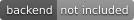
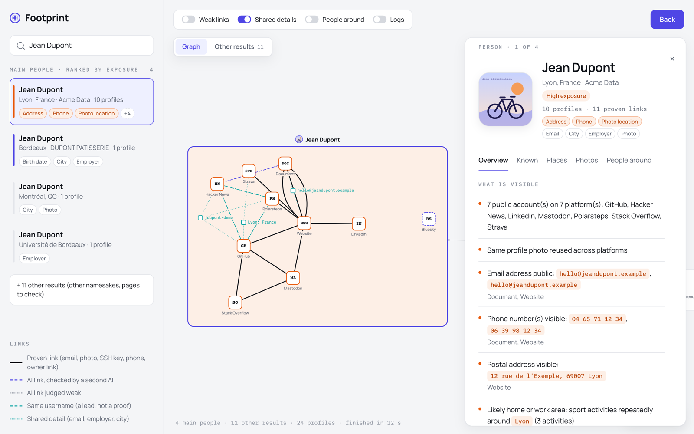
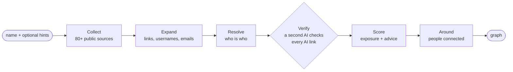
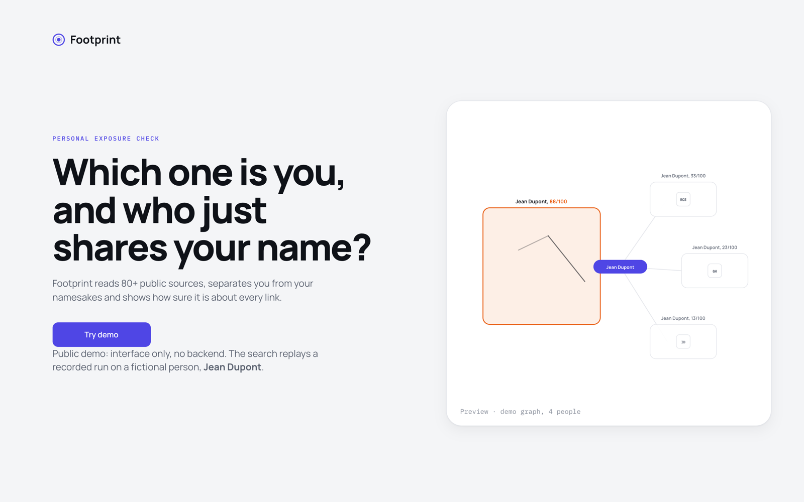
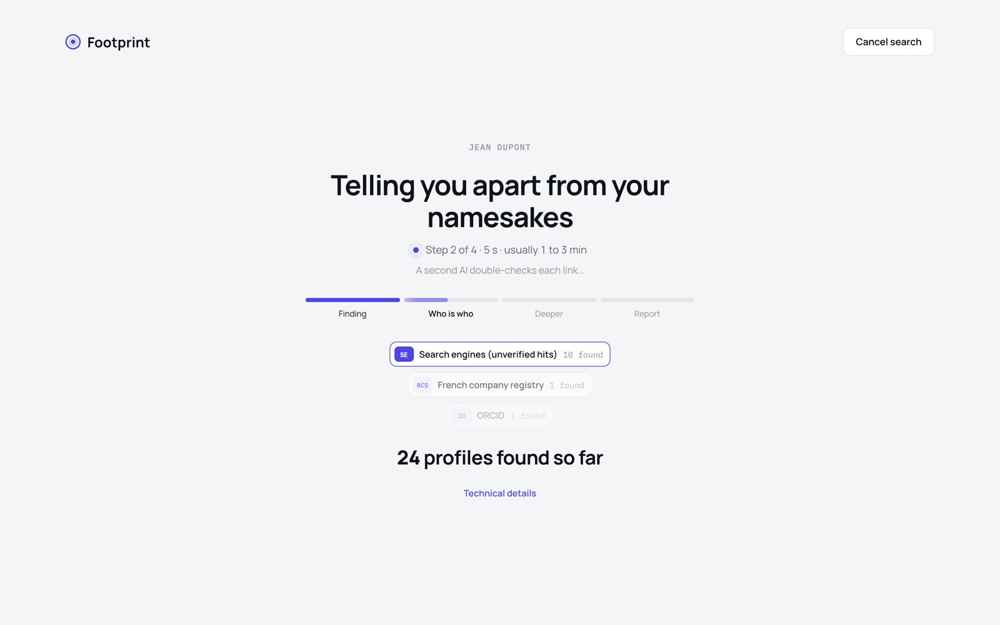
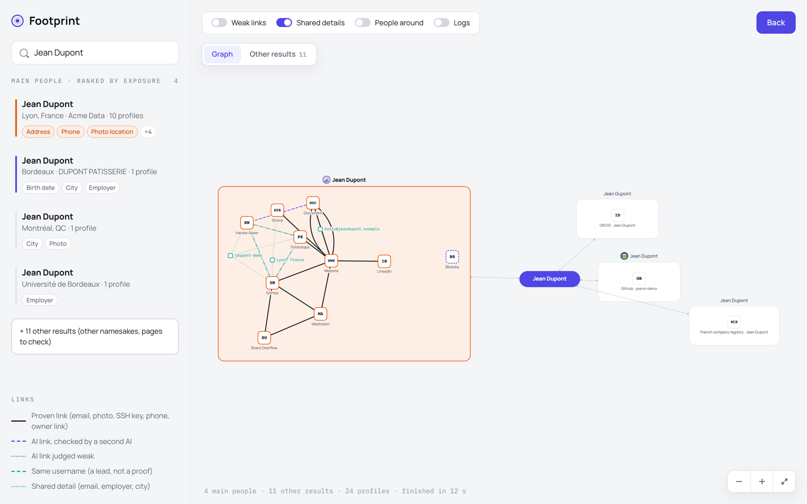
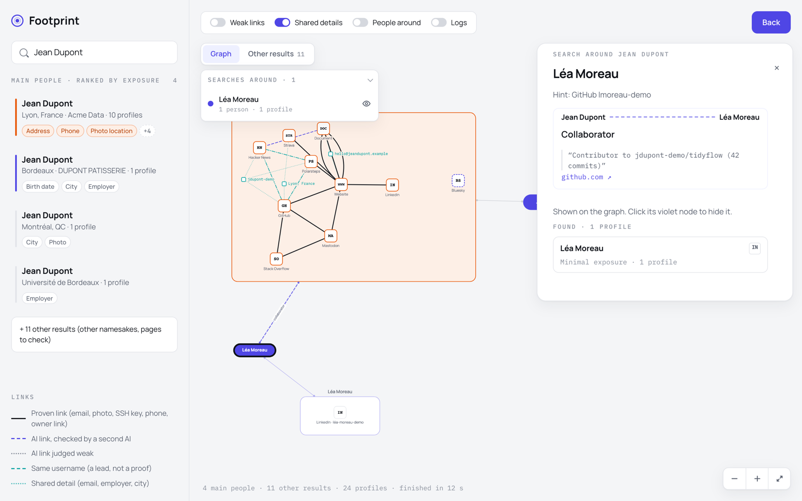

<div align="center">

# footprint





### Type a name, see which accounts belong to you, which belong to your namesakes, and how sure the AI is about every link.

**[▶ Try the interactive demo](https://julien-clnn.github.io/footprint/)**

</div>

<p align="center">
  
</p>

<p align="center"><sub>The demo person, <b>Jean Dupont</b>, is fictional: every name, handle, address, phone number and photo is invented (<code>.example</code> domains, phone numbers reserved for fiction).</sub></p>

## What this repository is

The **interface** of Footprint, a personal-exposure tool, with a recorded run of its offline demo.
It is display code only:

- **no backend, no AI call, no network search**: the page cannot look anyone up, and there is no
  field to type a name;
- **Try demo** replays a recorded search on the fictional Jean Dupont, step by step, exactly as the
  real app streams it; `src/mock.js` answers the API calls in the browser;
- the search pipeline (sources, entity resolution, verification, scoring) stays private.

The goal is to let anyone see the tool, click through it and understand what it does.

## Highlights

- **Namesakes kept apart**: the result is not one big list of accounts, but one cluster per person
  sharing the name (here four Jean Duponts: Lyon, Bordeaux, Montréal, Bordeaux University).
- **Every link is explained**: a proven link (same email, same photo, same SSH key, a link
  published by the owner) is drawn differently from an AI link checked by a second AI, a weak one,
  or a shared username that is only a lead.
- **Exposure score per person**: what is publicly visible (address, phone, photo location, employer…)
  with the profiles showing each fact, a timeline, places on a map and advice.
- **People around**: people publicly connected to someone (collaborators, co-directors, family
  found in directories), each with its source and quote, searchable right on the graph.
- **Live progress**: the search streams to the browser (Server-Sent Events) as it runs.

## How it works



The full app is a Python 3.12 / FastAPI backend orchestrated with LangGraph, with an LLM
(DeepSeek or Mistral) used only where rules are not enough, and every AI claim kept only if it can
be traced back to the collected data. That part is **not** in this repository.

## Tour of the demo

| | |
|---|---|
|  |  |
| **Start**: one button runs the demo search on Jean Dupont. | **Progress**: the four phases stream live. |
|  |  |
| **Result**: one cluster per namesake, the other results aside. | **People around**: a connected person is searched on the same graph. |

Things to try in the demo, after clicking **Try demo**:

1. Click a person in the left column, then the **Known**, **Places**, **Photos** and **People around** tabs.
2. Turn on **Shared details** and **Weak links** in the toolbar to see why accounts are tied together.
3. Open **Other results** for the search hits that could not be confirmed.
4. In **People around**, click **Search on the graph**: a new node grows from the person.

## Stack

| Area | Details |
|---|---|
| Interface (this repo) | React 19 + Vite, Cytoscape graph (fCoSE layout), Leaflet maps |
| Demo data | A recorded run of the offline demo (`src/demo-data.json`), replayed by `src/mock.js` |
| Hosting | GitHub Pages, built by GitHub Actions on every push (`.github/workflows/pages.yml`) |
| Backend (private) | Python 3.12, FastAPI, Server-Sent Events, LangGraph state graph |
| AI (private) | DeepSeek or Mistral, a second pass that verifies every AI link |

## Repository layout

```
src/
  App.jsx, Landing.jsx, Progress.jsx     pages: start, search in progress, result
  Graph.jsx, graph.js                    the graph (Cytoscape) and how a result becomes nodes
  Details.jsx, People.jsx, Leads.jsx     person panel, people list, other results
  Around.jsx, Subsearches.jsx            people around, searches drawn on the graph
  Places.jsx, Photos.jsx, exposure.jsx   map, photos, exposure score
  mock.js, demo-data.json                the in-browser API and the recorded demo
public/demo/                             demo illustrations (not real photos)
```

## Run it locally

```bash
npm ci
npm run dev        # http://localhost:5200
```

`npm run build` writes the static site to `dist/`.

## Responsible use

Footprint is meant to check **your own** exposure, or someone's with their consent. Everything
shown here is fictional; any resemblance to a real person is coincidental.

## License

© Julien. All rights reserved: the code is published so the demo can be viewed and read.
